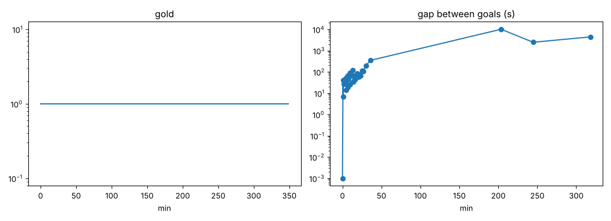
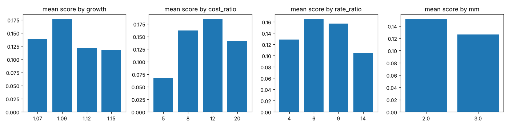
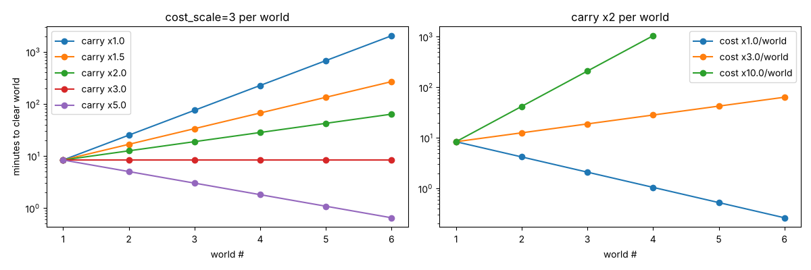
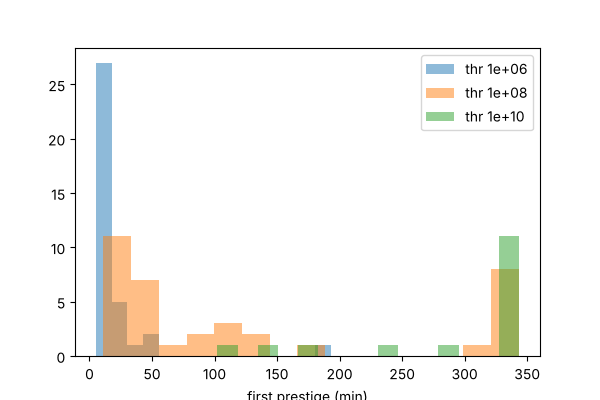
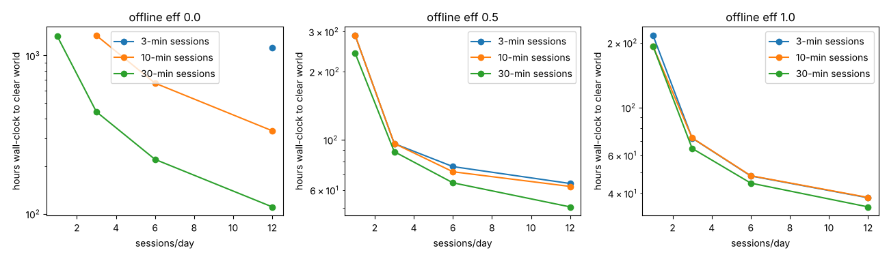
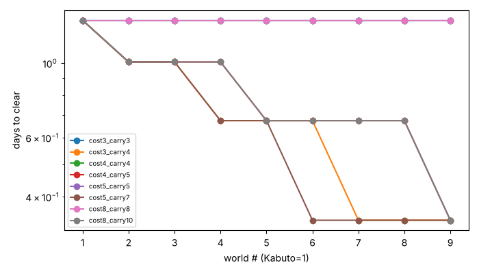

> **STATUS (v3 review pass, REVIEW_2):** everything here is a toy greedy-player model, **not validated against real player data**. Sections are layered by date: *Sweep / Worlds / Prestige sweep / Sessions / Decade campaign model* are v1 (no rides/carry sources) and are kept for the **tier-shape** result only; their world-length and "weak active reward" conclusions are **superseded** by *Campaign sim v2/v3* below. Re-run commands are listed under *Tooling*. Quantisation: v2 numbers are session-granular (≈0.33 d). Goal counts in v2 sections counted repeated goals; v3 counts unique goals.

# Simulation results (living document)
Code: `sim.py` (greedy-payback player), `sweep.py` (512 configs), `worlds.py` (sequential worlds). Charts: `baseline.png`, `sweep_params.png`, `worlds.png`. Raw: `sweep.json`, `worlds.json`.
Model: 8 tiers; cost_i = base*cost_ratio^i * growth^owned; rate_i = rate_ratio^i; x`mm` multiplier at ownership milestones; tier i+1 unlocks at 5 owned of tier i. "Goal" = first purchase of a tier or hitting a milestone count. Satisfying band = 15-600 s between goals; wall = gap > 30 min.

## Sweep (3 h horizon, 512 configs: growth {1.07,1.09,1.12,1.15} x cost_ratio {5,8,12,20} x rate_ratio {4,6,9,14} x 4 milestone sets x mult {2,3})
- Best configs have **cost_ratio / rate_ratio ~ 1.2-1.5** (e.g. 8/6, 12/9, 20/14). Ratio ~1 -> tiers all equally good ROI, no reason to progress, goals arrive in <3 s bursts. Ratio >2 (5/14 inverted or 20/4) -> walls (max gap > 2 h).
- Worst configs: rate_ratio > cost_ratio (higher tiers pay so well the early game is skipped: median gap 0.1-2.5 s, frac in-band 4-8 %) and milestone starting at 5 with x3.
- Growth 1.07-1.15 matters less than ratios: 1.12/8/6/x2 gave 97 % of goals in-band, max gap 344 s, median 46 s, 32 goals in 3 h.
- Milestone multiplier x2 beat x3 on average (x3 compresses early goals and leaves later walls).
- Takeaway: the *shape* (cost ratio slightly above rate ratio between tiers + milestone doublers) beats the exact growth constant. Sweet spot growth 1.10-1.15.

## Sequential worlds
World clear time scales as (cost_scale / carryover)^world. Examples (minutes to clear world 1..6):
- carry x2, cost x3: 8.4, 12.6, 18.8, 28.3, 42.4, 63.6  -> gentle 1.5x lengthening, good "later worlds feel bigger".
- carry x3, cost x3: 8.4 flat -> every world same length.
- carry x2, cost x1: 8.4 -> 0.3 min (carry trivialises later worlds; anti-pattern).
- carry x2, cost x10: 8.4, 42, 209, 1047 min (walls).
Rule: choose cost_scale/carryover in [1.0, 1.5] per world; 1.0 = constant length, ~1.3 = lengthening worlds.
Caveat: toy model; no prestige inside worlds yet, no active-play spikes. See follow-up runs.

## Prestige sweep (108 configs, 6 h horizon, 6 tiers, growth 1.12; prestige_sweep.py / prestige_sweep.json / prestige_first.png)
Params: threshold (1e6/1e8/1e10 lifetime), point exponent (0.4/0.5/0.7), bonus per point (5/10/25 %), player prestiges when mult gain >= {1.5,2,3,5}x.
- Only 23/108 configs give a first prestige at 20-90 min AND >= 3 prestiges in 6 h (the "satisfying" band).
- Threshold 1e8 dominates the good set; 1e6 prestiges so early (<20 min) it's a tutorial reset, 1e10 pushes first prestige past 90 min or never.
- Exponent 0.5-0.7 with rebuy rule "prestige at >= 2x gain" gives a 22-45 min cycle repeating 8-14 times; exponent 0.4 shrinks returns (cycles stretch to ~48 min).
- Strong bonus (25 %/pt, exp 0.7) explodes final multiplier (9e4x) -> numbers outrun content; 5-10 %/pt keeps final mult 2e2-6e3x.
- Rule of thumb: first prestige ~25 min, then cycles 20-45 min, each cycle must be >= 2x faster to repeat the same content. Don't allow prestige before the player has seen >=60 % of the world's tiers.

## Sessions & offline efficiency (sim2.py, sessions_sweep.py, sessions.png; 48 configs)
World sized to take ~1.5-19 days (base cost 2e3, 6 tiers). Player does N sessions/day of M minutes; offline gains at efficiency `eff` capped at 8 h. Wall-clock minutes to clear (table cells = minutes):
| sessions/day x min | eff 0 | eff 0.25 | eff 0.5 | eff 1.0 |
|---|---|---|---|---|
| 1 x 10 | never (>60 d) | 25,930 (18 d) | 17,290 (12 d) | 11,530 (8 d) |
| 3 x 10 | 80,170 (56 d) | 9,130 (6.3 d) | 5,770 (4 d) | 4,330 (3 d) |
| 6 x 10 | 40,090 | 7,210 | 4,330 | 2,890 |
| 12 x 10 | 20,050 | 5,770 | 3,730 | 2,290 |
Findings:
- Offline efficiency is the dominant lever: going from eff 0 to 0.25 speeds a 3x10 player ~9x; 0.25 -> 1.0 gives only another ~2x.
- Quadrupling sessions (3->12/day) at eff 0.5 speeds the world just 1.5x (5,770 -> 3,730 min): heavy players are not hugely rewarded, light players are not punished — good for "no-fight" casual design but means the active layer must carry its own appeal (events/clicks), not raw speed.
- Session length barely matters at eff >= 0.25 (3, 10, 30-min sessions all within ~25 %) because greedy purchasing is gated by accumulated gold, not by attention.
- Design consequence: choose offline eff 0.5 (cap 8 h) and size a world as ~3-5 days for a 3-sessions/day player, ~2 days for a heavy one.
Caveat: toy model with a purely greedy buyer; real players also decide among upgrade types, which this ignores.

## Decade campaign model (decade_model.py, decade_model.json, decade_model.png)
9 worlds (Kabuto, Den-O, Faiz, Ryuki, Blade, Kiva, Agito, Hibiki, Kuuga); 6-tier ladder each; world w costs scale by s^w; carryover multiplier c^w; 3 sessions/day x 10 min, offline eff 0.5, cap 8 h; world clear = top tier x25. Clear times in days (checked only at session granularity, so values are quantised to ~0.33 d):
| cost scale s / carry c | per-world days (W1..W9) | total |
|---|---|---|
| 3 / 3, 4 / 4, 5 / 5, 8 / 8 (c = s) | 1.3 every world | 12.1 d |
| 3 / 4 (c = 1.33 s) | 1.3, 1.0, 1.0, 0.7, 0.7, 0.7, 0.3, 0.3, 0.3 | 6.4 d |
| 5 / 7 (c = 1.4 s) | 1.3, 1.0, 1.0, 0.7, 0.7, 0.3 ... | 6.1 d |
Confirms the closed form: world length ratio = s/c. c = s gives equal-length worlds; c > s makes the campaign accelerate (late worlds feel trivial) — the toy model's carry is too generous at c = 1.33 s, so aim c ~ 0.8-1.0 s (slightly lengthening worlds) and instead raise the *reward density* (new mechanics) in late worlds. Base world length of 1.3 d here is only a scale choice (base_cost); real target: 3-5 days/world for casual (see sessions table) -> 9 worlds ~ 4-6 weeks.

## Robustness to player behaviour (robustness.py / robustness.json; 10 seeds each, 3 h)
"good" = growth 1.12, cost/rate ratio 8/6, milestones 10/25/50/100 ×2; "bad" = 5/14 with ×3 milestones from 5.
| config / player | median gap | max gap | goals in 15–600 s band |
|---|---|---|---|
| good, greedy | 46 s | 344 s | 97 % |
| good, noisy (30 % picks from top-3) | 45 s | 351 s | 95 % |
| good, noisy (60 %) | 46 s | 347 s | 89 % |
| good, checks every 60 s | 60 s | 360 s | 84 % |
| good, checks every 10 min | 0 s (batched) | 600 s | 28 % |
| bad, any player | ~0.1 s | 8,760 s | 4–18 % |
Findings: the good/bad ranking is independent of player strategy (picking sub-optimally barely changes pacing because costs are tight-ladder); infrequent checkers don't see "gaps" but *bursts* — after a 10-min absence many goals are ready at once, which argues for an auto-spend/"while away" summary (offline card) rather than making the player click through 10 purchases. Bad configs are bad for everyone: a 2.4 h wall appears whatever the player does.

## Charts
 baseline gold and goal gaps.
 mean score by parameter (512-config sweep).
 world clear time vs carryover/cost scale.
 first-prestige timing distribution.
 wall-clock hours to clear vs sessions/day and offline efficiency.
 9-world campaign model.

## Campaign sim v2 — sessions + stepped offline + Final Form Rides + world hops (campaign.py, campaign.json) [answers REVIEW_1 #1, #2, #4]
Setup: 8 tiers/world (×8 cost, ×6 rate), growth 1.12, milestones 10/25/50/100/200 ×2; world w costs ×s^w; carryover c^w; Seals = floor(sqrt(run_lifetime/T)), +8 %/seal, player rides when pending ≥ 2× seals and ≥4 tiers seen; world cleared when lifetime shots ≥ goal·s^w. Player: 3 sessions/day × 10 min; offline = 50 % for first 2 h, 25 % beyond, cap 8 h (R23, avg ≈0.31 for an 8 h gap). Metrics at *session* level: share of sessions containing ≥1 goal (first purchase of a tier, milestone, or ride) and longest run of "dry" sessions.
Goal size sets world length (cost x3, carry x3; days per world): goal 1e17 → 2.0 d, 1e18 → 3.0 d, 1e19 → 5.0 d, 1e21 → 18.7 d (with 34 % of sessions containing a goal and 25 dry sessions in a row = 8 days of nothing new).
Goal 1e18, 9 worlds, days per world (total days):
| cost scale / carry | W1 … W9 | total | share sessions with goal (W1–W4) | max dry sessions |
|---|---|---|---|---|
| 3 / 3 (ratio 1.00) | 3.0 flat | 27 | 100 % | 0 |
| 3 / 2.8 (1.07) | 3.0, 3.3, 3.3, 3.7, 3.7, 4.0, 4.0, 4.0, 4.0 | 33 | 90–100 % | 1 |
| 3 / 2.5 (1.20) | 3.0, 3.3, 4.0, 4.0, 4.7, 6.0, 7.0, 7.7, 8.7 | 48 | 83–100 % | 2 |
| 4 / 3.2 (1.25) | 3.0 … 11.3 | 57 | 79–100 % | 2 |
Findings:
1. Ratio and length reconcile: ratio 1.0–1.07 gives "3–4 days every world, ~4.5 weeks total"; ratio 1.2 gives 3 → 8.7 days, ~7 weeks; ratio ≥1.25 makes late worlds 11+ days with dry sessions. Previous docs' mixed statements (1.0–1.5, 5–8 weeks vs 4–6) are superseded: **use ratio 1.0–1.2; flat worlds ≈ 27–33 d, lengthening worlds ≈ 48 d.**
2. Rides in a session model cluster at session starts: with T = 1e6, world 1 has its first ride at ~7 min (inside session 1) and then **one ride cluster per returning session** (rides at ~480 min, 490 min, 966 min, 1440 min…) because a night of offline accrual makes pending seals jump. So "20–45 min cycles" (from the continuous-time prestige sweep) is not the right unit for a mobile game; the right unit is **1 ride per 1–2 sessions, ≈ 8–12 per 3-day world**.
3. Raising T0 delays the first ride (T = 1e4 → 3 min, 1e5 → 4 min, 1e6 → 7 min, 1e7 → 9 min of first-session play) but also stretches the world (1 d → 6.3 d): ride frequency is the main world-length lever, not the generator costs.
4. Goal density at multi-day length: a world with 8 tiers × (1 + 5 milestones) ≈ 48 purchases-goals + ~11 rides ≈ 60 goals. At 3 days (9 sessions) that gives ≥1 goal in 90–100 % of sessions. At 18 days only 34 % of sessions had a goal. → a world must contain ≥ ~6 goals per session-day ≈ 15–20 content beats per world-day or be ≤4–5 days long (R19 revised).
Limitations: still greedy, 3 sessions/day exactly, no active layer, gap metric counts a goal only if it is a tier/milestone/ride (a smarter model would include upgrade-tree purchases, adding goals).

## Campaign sensitivity sweep (campaign_sweep.py / campaign_sweep.json; 144 configs, world 1, goal 1e18)
Median days to clear world 1 by factor (others varied): sessions/day 1 → 10.5 d, 2 → 5.8 d, 3 → 4.0 d, 6 → 2.5 d; offline cap 4 h → 6.4 d, 8 h → 5.2 d, 24 h → 4.8 d; bonus/seal 2 % → 10.0 d, 5 % → 6.0 d, 8 % → 4.3 d, 10 % → 3.7 d; ride threshold T0 1e5 → 2.5 d, 1e6 → 5.1 d, 1e7 → 11.0 d.
32/144 configs met "world 2–5 d, ≥90 % of sessions with a goal, first ride ≤15 min"; the common pattern: T0 = 1e5–1e6, bonus 5–10 %/seal, 2–3 sessions/day.
**Important correction to sessions/offline findings (v1 said 4× sessions → only 1.5× faster):** once rides exist, progress scales almost inversely with sessions/day (1 → 6 sessions: 10.5 → 2.5 d, 4.2× faster) because each returning session triggers a ride cluster (offline accrual makes pending seals jump). So with prestige the game *does* reward frequent play — roughly proportional to sessions up to ~3/day — while the offline cap barely matters beyond 8 h (8 h → 24 h only 5.2 → 4.8 d). Design levers to blunt this if undesired: ride cooldown, sqrt of *time* in the pending formula, or per-world ride limit; or accept it as the "active layer" and size worlds for the 2-session/day median (≈5.8 d) with heavy players at ≈2.5 d.
Lever ranking for world length: ride threshold T0 (×4.4 over 1e5…1e7) > bonus/seal (×2.7 over 2–10 %) > sessions/day (×4.2 over 1–6, player-controlled) > offline cap (×1.3).

## Build balance (builds.py / builds.json) — do ≥2 viable builds exist? [REVIEW_1 missing-rule 1, R13]
Three mastery branches on world 1 (campaign model, goal 1e18): SPEED (×f per node, 2 nodes), CAST OFF (extra ×a at 40 owned for tiers ≥4 after 1 point, ×b after 2), RECIPES (offline eff 0.5→0.65 and ride threshold T×r). Points = 1 per ride (≤3 per branch).
First attempt (f=1.5, a/b=3/5, no ride change for Recipes): clear days (3 sessions/day, T0 1e6): none 3.0, speed 2.0, cast-off 1.67, **recipes 3.0** → the Recipes branch (offline-only) did nothing, confirming offline efficiency is a weak lever once rides exist; branches were unbalanced (spread 1.2–1.8×).
Search over f ∈ {1.2,1.3,1.5}, (a,b) ∈ {(1.5,2),(2,3),(3,5)}, r ∈ {0.3,0.5,0.7} (27 combos × 3 scenarios): best spread (slowest/fastest build) = **1.17×** at f=1.3, (a,b)=(2,3), r=0.3–0.5; next 1.25×. Granularity is 0.5 days so treat ±10 % as noise.
Design consequence: **a build branch that only changes offline efficiency is a trap**; make the "idle/offline" build change ride economics (cheaper rides) instead. Balanced numbers adopted in prototypes/decade_slice_v2.html: Speed ×1.3 ×2 nodes, Cast Off ×2 then ×3, Recipes: offline 65 % and rides need 50 % less. All three builds clear within 17 % of each other (satisfies R13 "≥2 viable builds"; target ≤25 % spread).

## Event-layer budgets (events.py) [answers research/events_and_choices.md §5.9 items 1–3]
1. **Photo Window** (spawn every 90–240 s while foregrounded, first guaranteed at 150–180 s; outcomes windfall 35/frenzy 30/quick 15/spotlight 15/card 5; banked offline "Exposures" 1 per 30 min cap 6, delivered at half value): expected value ≈ 119 production-seconds per window. For a 3×10 min/day player at 30–60 % hit rate windows add **28–37 % to active-session gain but only 2.5–3.6 % of daily progress** (offline production dominates: ≈26,000 production-seconds/day vs ≈1,000 from windows). At 1 session/day windows are 5–6 % of daily progress; at 6 sessions 3.5–5.6 %. Conclusion: the proposed Photo Window satisfies the R34/R38 budget (≤1.2× average; here ≈1.03–1.06×) and hits the 25–35 % active-session target at 3 sessions/day with a ~30–60 % hit rate. It makes active sessions *feel* rewarding without changing the pacing plan.
2. **Form Deck** (6 forms × 3 slots, 3:2:1 strengths, each form splits an equal power budget randomly over production/offline/charge, with axis values 1.0/0.6/0.4): best loadout is **+17.6 % over the median loadout and +41 % over the worst** (400 random decks), but the top-3 loadouts are within ≈1 % of each other. So the choice matters (a bad deck costs ~30 % vs the best) yet there are several equally good decks — good for R13b (≥2 viable builds) and no single "solved" deck. Sim only covers one axis weighting; add synergies for real depth.
3. **Achievement multiplier** 1.05^rows·1.01^count: world 1 ×1.29, world 3 ×2.16, world 6 ×4.67, world 9 ×10.09 (matches the agent's hand calc). Keep it applied to base Shots only and cap total from collections near ×10 so it doesn't overwhelm world carry (c≈2.5–3 per world).
Not simulated yet: challenge reward budget (automation vs ×1.15 stack, ≤×3.1), garden adjacency board cap (+20–25 % for 9 cards).

## Tooling
- `sim/pacing_report.py [growth cost_ratio rate_ratio]` — prints PASS/FAIL checks against DESIGN_RULES (R2, R9, R10, R16, R25). Recommended config 1.12/8/6 passes all; the "bad" config 1.15/5/14 fails 7 of 9 checks.
- `sim/test_sim.py` — unit tests (cost formula, milestones, stepped offline, no soft-lock after reset, flat worlds at ratio 1).
- Re-run order: `python3 sweep.py; python3 prestige_sweep.py; python3 sessions_sweep.py; python3 worlds.py; python3 decade_model.py; python3 campaign.py 1e18; python3 campaign_sweep.py; python3 builds.py; python3 events.py; python3 robustness.py`.

## Player archetypes × world scaling (population.py / population.json) — campaign length, goal density
Goal 1e18, 9 worlds, 8 tiers, rides ≥2× rule, stepped offline. Total campaign days (and the worst-world share of sessions with ≥1 goal / longest run of dry sessions):
| sessions/day | flat (ratio 1.0) | gentle (1.07) | lengthening (1.2) |
|---|---|---|---|
| 1 | 81 d (100 % / 0) | 99 d (83 % / 2) | 147 d (68 % / 6) |
| 2 | 40.5 d (100 % / 0) | 49.5 d (83 % / 2) | 73.5 d (68 % / 6) |
| 3 (casual) | 27 d (100 % / 0) | 33 d (83 % / 2) | 48 d (69 % / 5) |
| 4 | 22.5 d (90 % / 1) | 26.5 d (77 % / 2) | 41.5 d (60 % / 5) |
| 6 (heavy) | 16.5 d (82 % / 2) | 20.8 d (73 % / 2) | 32.7 d (52 % / 7) |
Findings: (1) campaign length is almost exactly ∝ 1/sessions-per-day, so the "same game" spans 17–147 days across archetypes; (2) the flat variant keeps ≥90 % goal density up to 4 sessions/day; (3) every step toward lengthening worlds costs goal density (dry-session streaks of 5–7), so **lengthening worlds only work if later worlds add content beats (R32) — recommend the gentle variant (ratio ≈1.07) with beat density rising per world**; (4) heavy players see less goal density because they exhaust beats faster — give them optional challenges/replay modes (R31).
